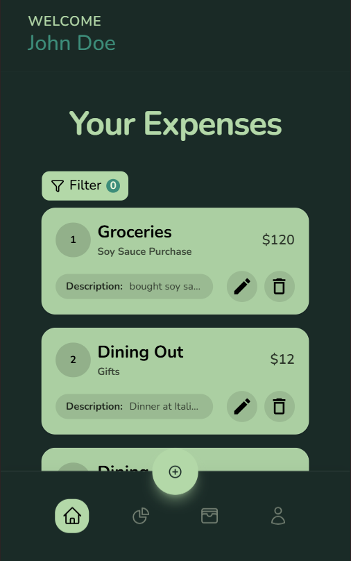
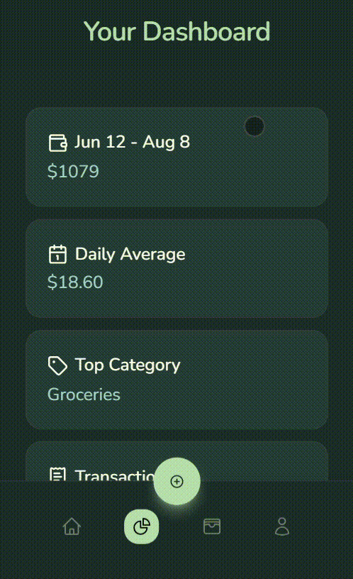
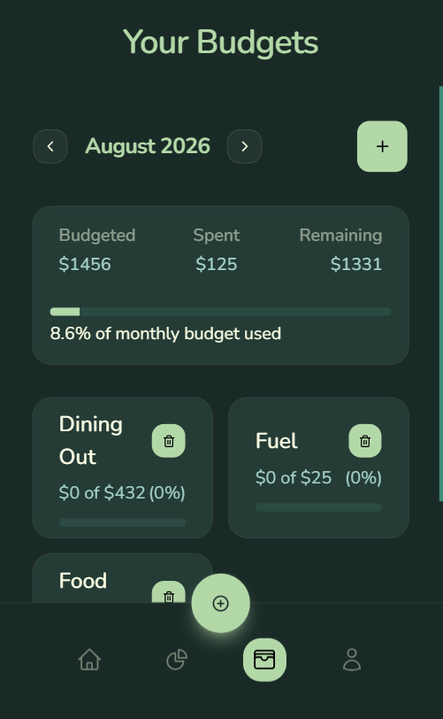

<div align="center">


# AI-Powered Expense Tracker

A full-stack web application designed to simplify personal finance through intelligent automation.

[](https://react.dev)
[](https://vitejs.dev)
[](https://tailwindcss.com)
[](https://reactrouter.com)
[](https://tanstack.com/query)
[](https://supabase.com)
[](https://ai-powered-expense-tracker-app-theta.vercel.app/)


</div>

---

## Screenshots

| Home                               | Dashboard                                    | Budgets & Goals                          |
| ---------------------------------- | -------------------------------------------- | ---------------------------------------- |
|  |  |  |

## Table of Contents

- [About](#about)
- [Features](#features)
- [AI Integration](#ai-integration)
- [Tech Stack](#tech-stack)
- [Architecture](#architecture)
- [Getting Started](#getting-started)
  - [Prerequisites](#prerequisites)
  - [Installation](#installation)
  - [Environment Variables](#environment-variables)
  - [Supabase Backend Setup](#supabase-backend-setup)
  - [Running the App](#running-the-app)
- [Available Scripts](#available-scripts)
- [Routing](#routing)
- [Error Handling & Resilience](#error-handling--resilience)
- [Deployment](#deployment)
- [Roadmap](#roadmap)
- [Contributing](#contributing)
- [License](#license)
- [Author](#author)

## About

**AI-Powered Expense Tracker** is a full-stack personal finance app that lets users log expenses in natural language and has an LLM handle the tedious part — assigning a category and generating a short, readable name — instead of asking users to fill out a rigid form. On top of that foundation sits a dashboard for spending insights and a budgeting system for staying on track month to month.

The project is built with a feature-based frontend architecture, a Supabase backend (Postgres + Auth + Edge Functions), and a resilient data layer that degrades gracefully — offline detection, contextual error messages, and a curated fallback category list mean the app keeps working even when the AI layer doesn't.

## Features

**Authentication**

- Email/password sign-up and sign-in via Supabase Auth
- Google OAuth sign-in
- Route guarding — public routes (`/login`, `/signup`) and protected app routes are separated via dedicated `PublicRoute` / `ProtectedRoute` wrappers

**Expense Management**

- Create, edit, and delete expenses
- Server-side search, category filtering, min/max amount filtering, and date-range filtering
- Paginated expense list (10 per page)
- Separate filter UI patterns for desktop (persistent sidebar) and mobile (bottom sheet)

**AI-Assisted Categorization & Naming**

- A Supabase Edge Function suggests a spending category from the expense description
- A second Edge Function generates a short, human-readable name from the description and category
- A curated list of 76 real-world categories acts as a manual fallback if AI suggestion fails or times out — the flow never blocks the user from saving an expense

**Dashboard**

- Stat cards, spending charts (via Recharts), and a table of recent transactions

**Budgets & Goals**

- Category-level budgets with spend-vs-budget progress tracking

**Profile**

- Update email and password, sign out

**Resilience & UX polish**

- Offline detection that short-circuits requests before they hit the network
- Centralized error normalization mapping Supabase/network error codes to human-readable messages
- Toast notifications (Sonner) for async feedback
- Loading skeletons for list content

## AI Integration

Two Supabase Edge Functions power the "smart" part of adding an expense:

| Function                  | Input                     | Output                       | Purpose                                             |
| ------------------------- | ------------------------- | ---------------------------- | --------------------------------------------------- |
| `get-category-suggestion` | `description`             | `{ classifications: [...] }` | Suggests one or more likely spending categories     |
| `generate-expense-name`   | `description`, `category` | short name string            | Generates a concise, readable title for the expense |

Both are invoked from the client via `supabase.functions.invoke(...)`, keeping any LLM provider API key server-side rather than exposed in the browser bundle. The functions themselves aren't part of this repository (Edge Functions are deployed independently via the Supabase CLI) — you'll need to write and deploy your own, backed by an LLM provider of your choice (e.g. Groq, OpenRouter, or Hugging Face's Inference API).

If either call fails, times out, or the user is offline, the UI falls back to the static `fallbackCategories` list in `src/lib/utils.js` so category selection is always available.

## Tech Stack

| Layer         | Technology                                                                      |
| ------------- | ------------------------------------------------------------------------------- |
| Framework     | React 19, Vite 7                                                                |
| Routing       | React Router 7 (data router)                                                    |
| Server state  | TanStack Query 5                                                                |
| Backend       | Supabase (Postgres, Auth, Edge Functions)                                       |
| Styling       | Tailwind CSS 4 (CSS-first config), `tailwind-merge`, `class-variance-authority` |
| UI components | shadcn/ui (Base UI primitives), Lucide / Heroicons / React Icons                |
| Forms         | React Hook Form                                                                 |
| Charts        | Recharts                                                                        |
| Notifications | Sonner                                                                          |
| Fonts         | Inter & Nunito (variable, via Fontsource)                                       |
| Tooling       | ESLint, Prettier (with Tailwind class sorting)                                  |
| Deployment    | Vercel                                                                          |

## Architecture

The frontend follows a **feature-based structure** — each domain owns its own components, hooks, and pages, with cross-cutting concerns (API calls, shared UI, utilities) pulled into top-level directories.

```
src/
├── app/
│   └── App.jsx              # Router, QueryClient, top-level providers
├── components/
│   ├── common/               # Shared building blocks (AppButton, Input, Modal, Pagination...)
│   ├── layout/                # Page shells, error boundaries, 404 route
│   └── ui/                     # shadcn/ui primitives
├── features/
│   ├── authentication/         # Login, Signup
│   ├── expense/                 # Onboarding, Home, AddExpense, EditExpense
│   ├── dashboard/                # Charts, stat cards, recent transactions
│   ├── budgets&goals/            # Category budgets & progress
│   └── profile/                   # Account settings
│       └── {components,hooks,pages}/
├── services/                # One file per domain — thin wrappers around the Supabase client
│   ├── apiAuth.js
│   ├── apiExpenses.js
│   ├── apiBudgets.js
│   ├── apiCategories.js
│   ├── apiExpenseName.js
│   ├── apiProfile.js
│   └── supabase.js
├── lib/
│   └── utils.js              # cn(), error normalization, offline guard, fallback categories
└── utils/
```

**Path aliases** (configured in `vite.config.js` and `package.json#imports`):

| Alias           | Resolves to          |
| --------------- | -------------------- |
| `@/*`           | `./src/*`            |
| `#components/*` | `./src/components/*` |
| `#lib/*`        | `./src/lib/*`        |
| `#hooks/*`      | `./src/hooks/*`      |

## Getting Started

### Prerequisites

- Node.js 18+
- A [Supabase](https://supabase.com) project

### Installation

```bash
git clone https://github.com/porter-showcase-projects/ai-powered-expense-tracker-fin.git
cd AI-Powered-Expense-Tracker-App
npm install
```

### Environment Variables

Create a `.env` file in the project root:

```bash
VITE_SUPABASE_API_URL=your-supabase-project-url
VITE_SUPABASE_API_KEY=your-supabase-anon-key
```

### Supabase Backend Setup

This repo contains the frontend only. To run the full app, your Supabase project needs:

1. **Tables** — `expenses` and `budgets`, each scoped to `user_id`, with **Row Level Security enabled** and policies restricting reads/writes to `auth.uid() = user_id`.
   - `expenses`: `id`, `user_id`, `amount`, `category`, `name`, `description`, `created_at`
   - `budgets`: `id`, `user_id`, `category`, `amount`, `created_at`
2. **Auth** — email/password enabled by default; enable the **Google** provider if you want OAuth sign-in to work.
3. **Edge Functions** — deploy `get-category-suggestion` and `generate-expense-name` (see [AI Integration](#ai-integration)) via the Supabase CLI, with your chosen LLM provider's API key set as a function secret.

### Running the App

```bash
npm run dev
```

The app will be available at `http://localhost:5173`.

## Available Scripts

| Command           | Description                                      |
| ----------------- | ------------------------------------------------ |
| `npm run dev`     | Start the Vite dev server with hot module reload |
| `npm run build`   | Build the app for production                     |
| `npm run preview` | Preview the production build locally             |
| `npm run lint`    | Run ESLint                                       |

## Routing

| Path                       | Access    | Description                                       |
| -------------------------- | --------- | ------------------------------------------------- |
| `/`                        | Public    | Onboarding / landing page                         |
| `/login`                   | Public    | Sign in (email/password or Google)                |
| `/signup`                  | Public    | Create an account                                 |
| `/app/home`                | Protected | Expense list with search, filters, and pagination |
| `/app/dashboard`           | Protected | Charts, stat cards, recent transactions           |
| `/app/expenses/add`        | Protected | Add a new expense                                 |
| `/app/expenses/:expenseId` | Protected | Edit or delete an expense                         |
| `/app/budgets-and-goals`   | Protected | Category budgets and progress                     |
| `/app/profile`             | Protected | Account settings                                  |
| `*`                        | —         | 404 fallback                                      |

Public and protected routes are enforced via `PublicRoute` and `ProtectedRoute` wrapper components, so an authenticated user is redirected away from `/login`/`/signup` and an unauthenticated one away from `/app/*`.

## Error Handling & Resilience

A few things worth calling out beyond the feature list, since this is where a lot of the actual engineering time went:

- **Offline guard** — every API call runs `assertOnline()` first, throwing a clear network error immediately instead of letting a doomed request hit the wire.
- **Centralized error normalization** — Supabase/auth error codes and HTTP status codes are mapped to specific, human-readable messages (e.g. `invalid_credentials`, `email_not_confirmed`, `ai_timeout`) rather than surfacing raw backend errors to the user.
- **AI fallback** — if category suggestion fails or times out, the UI falls back to a manually curated list of 76 categories rather than blocking expense creation.

## Deployment

The app is deployed on [Vercel](https://vercel.com). Since this is a client-side-routed SPA, `vercel.json` rewrites all paths to `index.html` so deep links (e.g. `/app/dashboard`) resolve correctly instead of 404ing on refresh:

```json
{
  "rewrites": [{ "source": "/(.*)", "destination": "/" }]
}
```

To deploy your own instance: connect the repository in Vercel, set the two environment variables from [above](#environment-variables) in the project settings, and deploy — no additional build configuration is required.

## Roadmap

- [ ] Custom category management (create/edit/delete categories instead of the fixed fallback list)
- [ ] CSV/JSON export of expense history
- [ ] Recurring expenses
- [ ] Multi-currency support
- [ ] Account deletion flow

## Contributing

Contributions are welcome.

1. Fork the repository
2. Create a feature branch (`git checkout -b feature/your-feature`)
3. Commit your changes (`git commit -m "feat: add your feature"`)
4. Push to the branch (`git push origin feature/your-feature`)
5. Open a Pull Request

Please run `npm run lint` before submitting a PR.

## License

MIT License

## Author

**Brandon Porter**
[GitHub](https://github.com/porter-showcase-projects)
